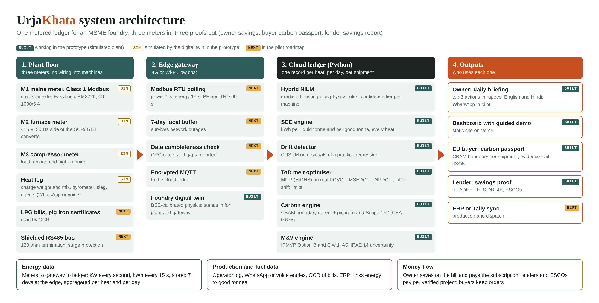

# UrjaKhata: the energy and carbon ledger for MSME foundries

[](https://github.com/YOUR-GITHUB-USERNAME/urjakhata/actions/workflows/tests.yml)

Prototype for the Schneider Electric **Yuva Yodha Energy Tech Hackathon 2026, Challenge 4 (Smart Manufacturing)**.

> Meter-verified savings an owner sees in rupees every morning, and carbon data an EU buyer can use.

- **Live demo:** `[your Vercel link]`. Click **Play demo** for a guided 10-step tour.
- **Demo video:** `[your video link]`



## What it does

Three meters (mains, induction furnace, compressor) and a WhatsApp heat log feed one ledger. The ledger produces three outputs:

1. **For the owner:** energy per good tonne for every heat, plus a 7:30 am briefing with the top three actions priced in rupees, in English or Hindi.
2. **For the EU buyer:** a carbon passport per shipment on the **CBAM boundary** (direct emissions plus pig-iron precursor emissions). Electricity emissions are reported separately, because CBAM does not price them for iron and steel.
3. **For the lender:** IPMVP Option B and Option C savings reports with ASHRAE Guideline 14 uncertainty bands, for ADEETIE, SIDBI 4E and ESCO finance.

## Results from the 90-day simulation (all simulated)

The baseline is days 1 to 28. The steady state is days 40 to 90, leaving out the injected lining-wear days 58 to 63. This run assumes operators adopt all the advice; the stress tests below relax that.

| Metric | Baseline | With UrjaKhata | Change |
|---|---|---|---|
| Furnace energy, kWh per liquid tonne | 650 | 610 | −6.2% |
| Plant energy, kWh per good tonne | 1,180 | 1,084 | −8.1% |
| Holding after melt-down, min | 17.8 | 7.7 | |
| Compressor, kWh/day | 257 | 156 | |
| Share of energy in peak hours (Gujarat ToU) | 41% | 14% | |
| Liquid metal, t/day | 4.98 | 5.02 | output held |
| Casting rejects | 5.0% | 5.0% | quality held |

**Annual figures** (1,500 t liquid, about 1,000 t good castings):
- **Energy:** 95.4 MWh saved, worth Rs 7.7 lakh.
- **Time-of-Day timing:** worth Rs 2.1 lakh, isolated by the optimiser on identical heats.
- **Total:** Rs 9.8 lakh.
- **Carbon:** 64.4 tCO2 at CEA 0.675, or 69.4 t at the CCTS factor 0.727.

**Verified savings** (days 29 to 90):
- Option B (furnace): 11,613 kWh (5.7%), 90% band 11,203 to 12,023 kWh.
- Option C (plant): 18,062 kWh (7.4%).

**Drift detection:** a hidden lining fault was flagged on heat D60-H02, 22 heats after it began. The early repair avoided 5,797 kWh.

**Kit:** Rs 0.99 to 1.5 lakh. Payback is 1.4 to 2.2 months at full adoption.

## Stress tests (`engine/robustness.py`, "Stress tests" view)

| Question | Test | Result |
|---|---|---|
| What if operators follow only part of the advice? | 1,000 runs: adherence 25 to 100%, compressed-air saving 25 to 100%, melt plan 50 to 100% of days, furnace efficiency 65 to 75%, tariff ±10%, kit price range | Rs 4.6 / **6.4** / 8.1 lakh a year (P10 / P50 / P90). Payback P50 2.8 months; every run under 6 months. Every input at its worst: Rs 2.7 lakh, 8 months |
| How often does the drift alarm cry wolf? | 400 simulated plant-months per case, threshold swept from 5 to 9 | 3% of months at the chosen threshold (19% at the first one). 2%, 5% and 10% faults caught in every run, median 53, 29 and 18 heats |
| Does it blame equipment for operator slips? | Superheat and slag drift back up, no equipment fault | Ours alarms in 14% of cases; a plain kWh/t CUSUM in 100% |
| Is one machine-split number trustworthy? | 5 independent renders, retrained each time | After a schedule change with a one-day re-label: 2.3% average energy error (simple share split 2.9%); on/off F1 0.94 against 0.55 |

**Tested on real factory data.** The machine split was also run on IMDELD, a public 1 Hz dataset from a feed factory in Brazil (IEEE DataPort), with the same model and protocol: learn from 4 labelled days, then measure the weekly energy error on up to 33 unseen days.

| Test | Machines | UrjaKhata, weekly energy error | Simple share split |
|---|---|---|---|
| A. Pelletizers metered (the UrjaKhata design), leftover split | Exhaust fan II; contactor II | 3.7% (High); 56.8% (Low) | 2.4%; 33.5% |
| B. Same circuit, nothing metered | 2 pelletizers, exhaust fan, contactor | 2.2% energy-weighted; 3 of 4 High | 2.8% |
| C. Two near-identical milling machines, nothing metered | Milling machines I and II | 3.2%; both High | 4.0% |

- 6 of 8 machine estimates were High confidence (1.2 to 4.0% weekly error).
- The test exposed a flaw the simulation could not: the energy-balance step assumed every machine in the leftover was labelled. With two unlabelled machines, the exhaust fan came out 34.6% high. An explicit "other, unlabelled" bucket fixed it (3.7%).
- The contactor fails because its identical twin is in the same leftover unlabelled; the tier flags it Low. Commissioning rule: clamp every machine in the leftover, or report look-alikes as one group.
- On these circuits machines start and stop together, so the simple split's timing is as good (F1 0.96 or better). The simulation's timing advantage did not carry over.

To reproduce: download the IMDELD CSVs from IEEE DataPort, then run `python -m engine.realdata /path/to/csvs` (about 7 minutes; writes `public/data/realdata.js`). The raw data is not redistributed here.

**What the simple alternatives showed.** On daily kWh per machine, a fixed-share split is close to the model, so the model earns its place through timing (which machine runs when). Without the one-day re-label after a schedule change, the model's error rises to 6.1%, worse than the simple split, so re-labelling is part of the product. See `docs/MODEL_CARD.md`.

**What is real and what is simulated:**
- **Sourced:** the furnace energy rules (BEE), the FY 2026-27 PGVCL tariff, CEA grid factors, CBAM rules and the ADEETIE terms.
- **Real data:** the machine-split test on IMDELD factory data.
- **Simulated:** the foundry and its data. Every other saving and accuracy figure above comes from the simulation.

## Repository layout

```
public/            the website Vercel serves (static: HTML, CSS, JS, precomputed data)
  index.html  css/style.css  js/app.js  js/story.js  js/vendor/ (Chart.js 4.4.1, MIT)  data/urjakhata-data.js  img/
engine/            Python engines that generate public/data
  config.py        every parameter, with source or "assumption" label
  tariff.py        effective ToU rates for PGVCL, MSEDCL, TNPDCL
  sim.py           BEE-calibrated foundry digital twin (10 s data, 90 days)
  nilm.py          hybrid NILM: gradient boosting plus physics rules, naive baseline, confidence tiers
  sec.py           energy per tonne, regression-residual CUSUM drift, rupee action cards
  tod.py           Time-of-Day melt scheduler (MILP, SciPy HiGHS) with shift constraints
  carbon.py        CBAM-boundary passport and Scope 1+2 footprint
  mv.py            IPMVP Option B and C with ASHRAE 14 uncertainty
  robustness.py    savings Monte Carlo, drift alarm reliability, multi-seed NILM check
  realdata.py      machine-split test on real IMDELD factory data
  pipeline.py      runs everything and writes public/data
tests/             14 pytest checks (BEE ranges, tariff maths, MILP constraints, CBAM boundary, NILM, robustness)
docs/              architecture diagram, model card, review notes, screenshots
data/              CSV outputs (heats, daily, NILM evaluation)
.github/workflows/ runs the tests on every push
vercel.json        static deployment settings
```

## Run locally

```bash
pip install -r requirements.txt
python -m engine.pipeline          # about 4 minutes; regenerates public/data
python -m pytest -q tests          # 14 tests, about 30 s
python -m http.server 8000 -d public   # open http://localhost:8000
```

Opening `public/index.html` directly in a browser also works, because the data loads as a script.

## Deploy on Vercel

1. Push this repository to GitHub, with the folders exactly as they are. In the badge link at the top of this file, replace `YOUR-GITHUB-USERNAME` with your GitHub username.
2. In Vercel, choose **Add New > Project**, import the repository and click **Deploy**. Leave **Root Directory** as `/`.
3. `vercel.json` sets `framework: null`, so Vercel does not try to build Python. It also sets no install or build command, and `outputDirectory: public`.
4. Confirm the **Framework Preset** shows **Other**.

No build step and no secrets are needed. To update the site, run the pipeline, commit `public/data`, and push.

## Key sources

- **BEE, Best Operating Practices Guide, foundry (Belgaum cluster):** 396 kWh/t theoretical, 10 kWh/t per 1% slag, 25 kWh/t per 50 °C superheat, up to 25 kWh/t open-lid loss, a 500 kg / 550 kW example, 65 to 75% efficiency.
- **BEE Foundry Sector Energy Mapping:** 600 to 750 kWh/t for induction melting.
- **SAMEEEKSHA Rajkot cluster profile:** 1,000 to 1,200 kWh per tonne of good castings.
- **GERC tariff schedule for PGVCL, w.e.f. 1 April 2026 (HTP-I):** 420 paise, peak +85 paise from 07:00 to 11:00 and 18:00 to 22:00, solar −60 paise from 11:00 to 17:00.
- **FPPAS:** Rs 2.45/kWh + 3.99% from July 2026 (secondary source). Electricity duty is 15%.
- **CEA CO2 Baseline Database v22.0 (Aug 2026):** 0.675 tCO2/MWh for FY 2025-26. The CCTS baseline uses 0.727.
- **EU CBAM (Reg. 2023/956; IR (EU) 2025/2621 and 2026/1740):** direct emissions are priced for iron and steel. Default mark-ups are 10%, 20% and 30% for 2026, 2027 and 2028 onward.
- **ADEETIE (Ministry of Power / BEE):** 5% interest subvention for micro and small units, 3% for medium.

See `docs/MODEL_CARD.md` for each model's tests and limits, and `docs/REVIEW.md` for the full verification and the expert-panel critique.

## License

MIT
